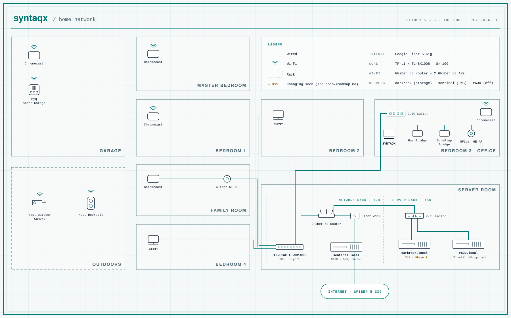

# my homelab

<picture>
  <source media="(prefers-color-scheme: dark)" srcset="assets/network-dark.svg">
  
</picture>

Two racks in the basement: a wall-mounted network rack where Google Fiber comes in, and a rolling
server rack below it. The diagram is generated from
[`scripts/network_diagram.py`](scripts/network_diagram.py); edit that and run
`python3 scripts/network_diagram.py assets` to redraw both themes.

## At a glance

| | Today | Next |
| --- | --- | --- |
| **Internet** | Google Fiber 5 Gig | 8 Gig, eventually |
| **Network core** | TP-Link TL-SX1008, 8× 10G | — |
| **Storage** | Darkrock (Unraid 7), 84 TB array, 79% full | 45HomeLab X15, 104 TB on day one |
| **Servers** | Darkrock (storage), Sentinel (DNS, tunnel); R630 off | Proxmox on the R630, after the UPS upgrade |
| **Power** | A 1U CyberPower UPS per rack; the server rack's is 62% loaded | ≥1,000 W UPS for the server rack |

## Docs

- [Racks](docs/racks.md): both racks, U-by-U
- Servers: [Darkrock](docs/servers/darkrock.md) · [Sentinel](docs/servers/sentinel.md) · [X15 (planned)](docs/servers/x15.md) · [R630](docs/servers/r630.md)
- [Storage](docs/storage.md): array layout and growth plan
- [Network](docs/network.md): internet, switching, links
- [Power](docs/power.md): UPS and load
- [Services](docs/services.md): what runs where
- [Roadmap](docs/roadmap.md): phased plan, costs and checklists
- Runbooks: [Darkrock → X15](docs/runbooks/x15-migration.md) · [R630 bring-up](docs/runbooks/r630-bringup.md)

## Basement

